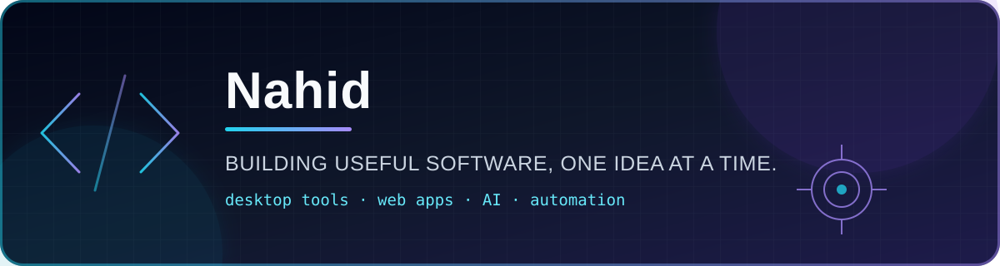

  

  
  

## Hey, I'm Nahid 👋

I'm a computer science student who enjoys turning ideas into practical software—from desktop utilities and interactive web experiences to APIs and automation.

- 🧩 Building clean, practical tools for everyday problems
- 🖥️ Building polished Windows desktop experiences
- 🤖 Experimenting with AI-powered APIs and useful automation
- 🧭 Interested in projects that solve a clear, everyday problem

## Featured projects

<table>
  <tr>
    <td width="50%" align="center" valign="middle">
      
    </td>
    <td width="50%" align="center" valign="middle">
      
    </td>
  </tr>
  <tr>
    <td valign="top">
      <h3>gflowris</h3>
      
Generate in Google Flow. Finish in Cutris.

      
<a href="https://github.com/nahidmrdl/gflowris">Repository</a> &nbsp;|&nbsp; <a href="https://github.com/nahidmrdl/gflowris/releases/latest">Download</a>

    </td>
    <td valign="top">
      <h3>cutris</h3>
      
Remove backgrounds. Crop, resize, and refine.

      
<a href="https://github.com/nahidmrdl/cutris">Repository</a> &nbsp;|&nbsp; <a href="https://github.com/nahidmrdl/cutris/releases/latest">Download</a>

    </td>
  </tr>
</table>

## Toolkit

  

## Let's build something useful

I like projects with a strong idea, a clear interface, and room to learn. If one of my repositories sparks an idea, open an issue or start a conversation.

  

